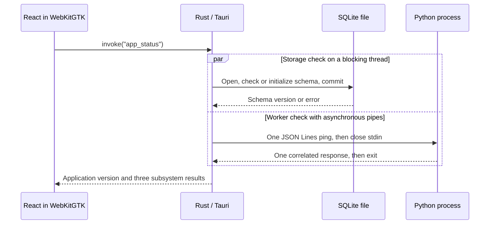

# MLKer Studio architecture

Milestone 0 establishes one working path through the desktop stack. Opening Home checks the Rust backend, the local database and the Python interpreter. Refresh runs those checks again. ONNX Inspector, Experiments and Settings have navigable placeholders. Model Builder opens the visual editor.

## Repository map

| Location | Responsibility |
| --- | --- |
| `src/main.tsx`, `src/style.css` | React navigation, views and service status |
| `src/status.ts` | Typed client of the Tauri command |
| `src-tauri/src/main.rs` | Native entry point, path resolution and command composition |
| `src-tauri/src/database.rs` | SQLite file, schema version and transaction |
| `src-tauri/src/worker.rs` | Child lifetime, protocol validation and timeout |
| `src-tauri/tests/` | Service integration tests with real processes and files |
| `python/mlker_worker/`, `python/tests/` | Python entry point and independent wire tests |
| `python/mlker_graph/`, `python/pyproject.toml` | Standalone graph package, v1 schema, validator and typed IR |
| `examples/models/v1/` | Valid architecture documents and invalid diagnostic fixtures |
| `docs/decisions/` | Reasons for the process and persistence boundaries |

## Status request

The application command takes no arguments. It returns an object with a `version` string and `backend`, `database` and `worker` objects. Each has an `available` boolean and a `detail` string for display. A successful invocation establishes that the backend is reachable. SQLite and Python can each fail independently. If the desktop bridge itself is unavailable, React shows the invocation error and marks service state unknown. The browser-only Vite preview uses that same display.

Tauri resolves the database directory using the application identifier. SQLite opens on a blocking thread because its file and lock operations are synchronous. An immediate transaction serializes schema initialization, including concurrent first launches. Version 1 reserves the application file for future metadata tables. Initialization checks the existing version before changing anything. The connection closes at the end of each check.

The Python service runs an interpreter executable with fixed arguments and the worker package directory from Tauri's resources. A fresh process per probe exercises startup and shutdown and keeps the implementation small. The ID is scoped to that child's pipes. Rust bounds the reply size and enforces a five-second exchange deadline. Python logs to inherited stderr. See the [worker protocol](worker-protocol.md).

## Reading the Rust code with a Python background

- A crate is a buildable Rust package component. The library exports the database and worker services. The binary registers the Tauri command and uses those same services. Cargo's `desktop` feature lets service tests run on a machine without GTK.
- `Result<T, E>` is a value that holds either a successful result or an error. The `?` operator returns an error to the caller early. The command converts service errors to displayable status.
- Ownership determines when resources close. Dropping the child's stdin sends EOF. Dropping a SQLite connection closes its handle, and dropping an uncommitted transaction rolls it back.
- `async` and `.await` allow other work to run during pipe I/O. `spawn_blocking` moves synchronous SQLite work to a thread that can wait on disk.

## Constraints for following milestones

| Risk | Decision to carry forward |
| --- | --- |
| Worker startup cost becomes material during ML workloads | Revisit worker reuse, cancellation and request multiplexing when a long-running operation exists. Preserve correlation and version checks. |
| A model workload consumes memory or introduces untrusted code | Keep tensors, media and weights on disk. Send references and small metadata over IPC. Model import requires an explicit isolation design. Python's isolated interpreter flags here only control its startup environment. |
| Persistence formats become coupled | Version worker IPC, the SQLite schema and model documents independently. Use versioned, framework-independent YAML and a separate typed graph IR for the future compiler. Keep architecture, weights and run metadata separate. |
| Experiment ingestion blocks interaction | Keep streaming TensorBoard ingestion, bounded caches and disk-backed aggregation behind services when tracking is introduced. |
| Desktop resource paths or Python installations vary | Resolve packaged files through Tauri, and support an explicit interpreter path. Exercise the bundled resource path in desktop smoke checks. |

## Model graph foundation

Milestone 1 adds a sibling Python package, `mlker_graph`. Its API and validation CLI run independently of the desktop process. The worker still ships with just its standard-library dependencies.

1. `load_model` parses restricted YAML into a `ModelDocument` containing the source path and complete data tree.
2. The validator dispatches on format and version, applies the bundled v1 schema, indexes scoped IDs and checks graph boundaries. It orders block definitions by dependency and resolves registry targets, parameter contracts and wiring.
3. `build_ir` publishes a typed model only after the checks pass. Edges reference resolved port objects. Block instances retain their stable target and bindings. Source locations link compiler diagnostics back to the document.
4. `save_model` serializes the validated document, including unfamiliar source fields. The IR can be discarded and rebuilt after an edit.

The [model format](model-format-v1.md) and [graph architecture decision](decisions/0003-model-graph.md) define the contract for a future editor and compiler. Milestone 2 implements the PyTorch backend in `python/mlker_graph/pytorch/`. It lowers the canonical IR into class plans with constructor calls, tensor values and parameter aliases, then renders and publishes the source project. Shape inference is local to each specialized graph call. The editor can consume the same validation and compilation APIs in a later milestone. See the [compiler guide](pytorch-compiler.md) and [export decision](decisions/0004-pytorch-export.md).

## Visual Model Builder

The editor in `src/editor/` projects the entry graph of a complete model document into an XYFlow canvas. Its model helpers update canonical endpoints, public port bindings and position extension data together. The Rust `EditorService` holds the persistent graph subprocess in a Tokio mutex, the asynchronous equivalent of a lock around the stdin/stdout exchange. Domain failures carry Python diagnostics through the Tauri invocation.

Debounced validation keeps one request running and at most the latest pending document. Registry metadata comes from the existing Python registry. Native dialogs select local input and destination paths. The worker runs the existing graph validator, YAML serializer and PyTorch compiler. See the [editor decision](decisions/0005-visual-editor.md) and [wire protocol](worker-protocol.md).
